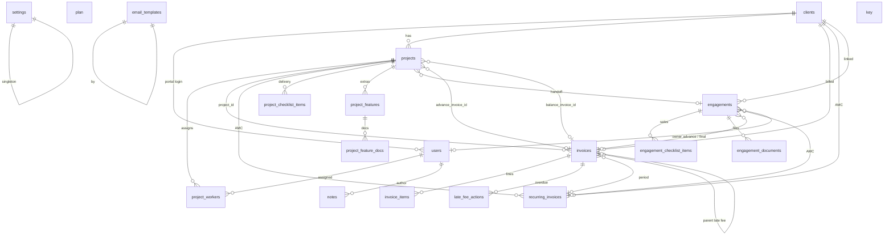

# KR Workspace — Database Structure

PostgreSQL schema for **KR Web Solution** ERP / CRM (`kr-erp-api`).  
Source of truth: `app/models.py` · Migrations: `alembic/versions/`.

**Money:** all amounts are stored as **paise** (`BigInteger`). ₹1 = 100 paise.  
**IDs:** string prefixes (`usr_`, `cli_`, `prj_`, `inv_`, …) + short hex.

---

## Entity relationship overview



---

## Tables

### 1. `users`
Auth accounts.

| Column | Type | Notes |
|---|---|---|
| `id` | `varchar(36)` PK | `usr_…` |
| `email` | `varchar(255)` unique | |
| `password_hash` | `varchar(255)` | bcrypt |
| `full_name` | `varchar(255)` | |
| `role` | `varchar(20)` | `admin` \| `founder_ceo` \| `worker` \| `client` |
| `client_id` | FK → `clients.id` SET NULL | required for client role |
| `is_active` | `boolean` | |
| `created_at` / `updated_at` | timestamptz | TimestampMixin |

---

### 2. `clients`
Billing / company accounts.

| Column | Type | Notes |
|---|---|---|
| `id` | `varchar(36)` PK | `cli_…` |
| `name` | `varchar(255)` | company / client name, required |
| `primary_contact_name` | `varchar(255)` null | person who deals with us |
| `designation` | `varchar(120)` null | contact job title |
| `contact_email` | `varchar(255)` null | person's email |
| `contact_phone` | `varchar(50)` null | person's number |
| `email` | `varchar(255)` null | company / official email (invoice destination) |
| `phone` | `varchar(50)` null | company / official number |
| `website` | `varchar(255)` null | |
| `address` | `text` null | |
| `city` | `varchar(120)` null | |
| `state` | `varchar(120)` null | |
| `pincode` | `varchar(20)` null | |
| `gstin` | `varchar(50)` null | |
| `notes` | `text` null | |
| `created_at` / `updated_at` | timestamptz | |

---

### 3. `leads`
Pre-pipeline inbound leads (convert → client ± project).

| Column | Type | Notes |
|---|---|---|
| `id` | `varchar(36)` PK | `led_…` |
| `name` | `varchar(255)` | |
| `company` | `varchar(255)` | |
| `contact_name` | `varchar(255)` | |
| `email` / `phone` | null | |
| `source` | `varchar(50)` | default `website` |
| `status` | `varchar(20)` | `new` \| `contacted` \| `proposal` \| `won` \| `lost` |
| `notes` | `text` null | |
| `created_at` / `updated_at` | timestamptz | |

---

### 4. `projects`
Delivery projects + **confirmed commercial terms** (Stage 05).

| Column | Type | Notes |
|---|---|---|
| `id` | `varchar(36)` PK | `prj_…` |
| `name` | `varchar(255)` | |
| `client_id` | FK → `clients.id` CASCADE | |
| `description` | `text` null | |
| `start_date` / `end_date` | `date` null | |
| `budget_paise` | `bigint` | confirmed total development (ex-GST) |
| `development_days` | `int` null | |
| `advance_paise` | `bigint` | confirmed advance (ex-GST) |
| `advance_invoice_id` | FK → `invoices.id` SET NULL | circular FK (`use_alter`) |
| `balance_invoice_id` | FK → `invoices.id` SET NULL | |
| `go_live_at` | `date` null | starts AMC / prorata |
| `status` | `varchar(20)` | `lead` \| `running` \| `on_hold` \| `stopped` \| `completed` |
| `delivery_phase` | `int` | 5–11 |
| `engagement_id` | FK → `engagements.id` SET NULL | pipeline handoff |
| `created_at` / `updated_at` | timestamptz | |

**API-only (not columns):** `balance_paise` = budget − advance; `invoiced_paise` / `remaining_paise` = sum of project-invoice subtots vs budget.

---

### 5. `project_workers`
M2M workers ↔ projects.

| Column | Type |
|---|---|
| `project_id` | FK → `projects.id` CASCADE (PK) |
| `user_id` | FK → `users.id` CASCADE (PK) |

---

### 6. `project_checklist_items`
Delivery checklist (phases 06–11).

| Column | Type | Notes |
|---|---|---|
| `id` | `varchar(36)` PK | `pci_…` |
| `project_id` | FK CASCADE | |
| `stage_number` | `int` | |
| `item_key` | `varchar(80)` | unique per `(project_id, stage_number, item_key)` |
| `label` | `varchar(255)` | |
| `sort_order` | `int` | |
| `is_done` | `boolean` | |
| `done_at` | timestamptz null | |
| `done_by` | FK → `users.id` SET NULL | |

---

### 7. `project_features` / `project_feature_docs`
Additional feature requests + notes/links.

**`project_features`:** `pft_…`, `project_id`, `title`, `description`, `status` (`requested` \| `approved` \| `in_progress` \| `done` \| `rejected`), `quoted_paise`, timestamps.

**`project_feature_docs`:** `pfd_…`, `feature_id`, `title`, `body_or_url`, `doc_type` (`note` \| `link` \| `spec`), `created_by`, `created_at`.

---

### 8. `invoices`
Tax invoices (project / maintenance / late fee).

| Column | Type | Notes |
|---|---|---|
| `id` | `varchar(36)` PK | `inv_…` |
| `invoice_number` | `varchar(100)` unique | from `settings.invoice_next_number` |
| `invoice_type` | `varchar(20)` | `project` \| `maintenance` \| `late_fee` |
| `client_id` | FK CASCADE | |
| `project_id` | FK SET NULL | |
| `recurring_id` | FK → `recurring_invoices` SET NULL | |
| `period_key` | `varchar(20)` null | e.g. `2026-11`; unique with `recurring_id` |
| `parent_invoice_id` | FK → `invoices` SET NULL | late fee parent |
| `status` | `varchar(20)` | `draft` \| `sent` \| `paid` \| `overdue` |
| `issue_date` / `due_date` | `date` | |
| `subtotal_paise` | `bigint` | ex-GST |
| `tax_rate_percent` | `numeric(5,2)` | default 18 |
| `tax_paise` / `total_paise` | `bigint` | |
| `notes` | `text` null | |
| `paid_at` | timestamptz null | |
| `reminder_count` | `int` | |
| `last_reminder_at` | timestamptz null | |
| `overdue_notified_at` | timestamptz null | |
| `email_status` | `varchar(20)` | `pending` \| `sent` \| `failed` |
| `email_error` | `text` null | |
| `email_retry_count` | `int` | |
| `last_emailed_at` | timestamptz null | |
| `created_at` / `updated_at` | timestamptz | |

---

### 9. `invoice_items`
Line items.

| Column | Type | Notes |
|---|---|---|
| `id` | `varchar(36)` PK | `itm_…` |
| `invoice_id` | FK CASCADE | |
| `description` | `varchar(255)` | |
| `quantity` | `numeric(10,2)` | |
| `unit_rate_paise` | `bigint` | |
| `amount_paise` | `bigint` | qty × rate |

---

### 10. `recurring_invoices`
AMC / monthly maintenance schedules (run after `projects.go_live_at`).

| Column | Type | Notes |
|---|---|---|
| `id` | `varchar(36)` PK | `rcr_…` |
| `client_id` | FK CASCADE | |
| `project_id` | FK SET NULL | |
| `amount_paise` | `bigint` | monthly ex-GST |
| `send_day` | `int` | 1–28 |
| `due_after_days` | `int` | |
| `reminder_every_days` | `int` | |
| `starts_on` / `ends_on` | `date` | |
| `line_items_template` | `json` | |
| `tax_rate_percent` | `numeric(5,2)` | |
| `day_of_month` | `int` | |
| `next_run_date` | `date` | |
| `active` | `boolean` | |
| `notes` | `text` null | |
| `created_at` / `updated_at` | timestamptz | |

---

### 11. `late_fee_actions`
Founder decisions on overdue invoices.

| Column | Type | Notes |
|---|---|---|
| `id` | `varchar(36)` PK | `lfa_…` |
| `invoice_id` | FK CASCADE | overdue invoice |
| `fee_paise` | `bigint` | |
| `fee_type` | `varchar(20)` | `fixed` \| `percent` |
| `fee_value` | `numeric(10,2)` | |
| `reason` | `varchar(255)` | |
| `send_on` | `date` | |
| `repeat_every_days` | `int` null | |
| `reminder_every_hours` | `int` null | overdue follow-up cadence |
| `next_reminder_at` | timestamptz null | |
| `repeat_count` | `int` | |
| `status` | `varchar(20)` | `pending` \| `scheduled` \| `sent` \| `waived` \| `extended` |
| `decided_by` | FK → `users` SET NULL | |
| `decided_at` | timestamptz null | |
| `late_fee_invoice_id` | FK → `invoices` SET NULL | generated fee invoice |
| `created_at` / `updated_at` | timestamptz | |

---

### 12. `engagements`
Sales pipeline deals (stages 01–05; handoff → project).

| Column | Type | Notes |
|---|---|---|
| `id` | `varchar(36)` PK | `eng_…` |
| `title` | `varchar(255)` | |
| `company_name` / `contact_name` | `varchar(255)` | company required; contact may be blank |
| `designation` | `varchar(120)` null | contact job title |
| `contact_email` / `contact_phone` | varchar null | person |
| `email` / `phone` | varchar null | company official |
| `website` / `address` / `city` / `state` / `pincode` / `gstin` | null | copied onto the client at link |
| `email` / `phone` | null | |
| `enquiry_source` | `varchar(50)` null | |
| `engagement_kind` | `varchar(20)` | `project` \| `amc_only` |
| `current_stage` | `int` | 1–11 (sales ≤ 5) |
| `status` | `varchar(20)` | `active` \| `hold` \| `lost` \| `completed` \| `maintenance` |
| `estimated_budget_paise` | `bigint` null | pipeline estimate |
| `quoted_paise` | `bigint` null | pipeline quoted |
| `advance_paise` | `bigint` null | pipeline expected advance (**not** project confirmed) |
| `lost_reason` / `lost_note` | null | |
| `notes` | `text` null | |
| `warranty_ends_on` | `date` null | |
| `client_id` | FK SET NULL | |
| `project_id` | FK → `projects` SET NULL | |
| `advance_invoice_id` / `final_invoice_id` | FK → `invoices` SET NULL | legacy links |
| `recurring_invoice_id` | FK → `recurring_invoices` SET NULL | |
| `owner_user_id` | FK → `users` SET NULL | |
| `created_at` / `updated_at` | timestamptz | |

---

### 13. `engagement_documents`
Pipeline file uploads (enquiry / brief / quote / other).

| Column | Type | Notes |
|---|---|---|
| `id` | `varchar(36)` PK | `edoc_…` |
| `engagement_id` | FK CASCADE | |
| `title` | `varchar(255)` | |
| `original_filename` / `stored_filename` | `varchar(255)` | |
| `content_type` | `varchar(120)` | |
| `size_bytes` | `int` | |
| `doc_kind` | `varchar(30)` | `enquiry` \| `brief` \| `quote` \| `other` |
| `uploaded_by` | FK → `users` SET NULL | |
| `created_at` | timestamptz | |

---

### 14. `engagement_checklist_items`
Sales stage checklists. Same shape as project checklist; unique `(engagement_id, stage_number, item_key)`. Prefix `eci_…`.

---

### 15. `notes`
Polymorphic notes on clients / leads.

| Column | Type | Notes |
|---|---|---|
| `id` | `varchar(36)` PK | `not_…` |
| `entity_type` | `varchar(20)` | `client` \| `lead` |
| `entity_id` | `varchar(36)` | |
| `author_id` | FK → `users` SET NULL | |
| `body` | `text` | |
| `created_at` | timestamptz | |

---

### 16. `settings`
Singleton company + SMTP + invoice counter (`id = 'default'`).

| Column | Notes |
|---|---|
| `company_name`, `company_address`, `company_gstin`, `company_logo_url` | brand |
| `invoice_prefix`, `invoice_next_number` | numbering |
| `default_tax_rate`, `payment_terms`, `bank_upi_details` | invoice defaults |
| `smtp_*`, `smtp_password_encrypted` | Fernet-encrypted password |
| `invoice_cc_email` | |

---

### 17. `email_templates`
Keyed templates (`invoice_sent`, `payment_reminder`, `lead_welcome`, `password_reset`, …): `id`, `subject`, `body`.

---

## Domain flow (sales → delivery → billing)

```text
Lead ──convert──► Client
                    │
Engagement (pipeline stages 01–05)
  estimated / quoted / advance  = estimates only
                    │
         Stage 05 Convert
                    ▼
Project (confirmed budget / advance / days / AMC)
  ├── advance_invoice_id  → Invoice (project, due +5 days)
  ├── balance_invoice_id  → Invoice (optional)
  ├── go_live_at          → prorata + RecurringInvoice monthly
  └── engagement_id       → pipeline docs / notes / checklist
```

---

## Alembic migrations

| Revision | File | Summary |
|---|---|---|
| `001` | `aadf61f35e83_001_core_schema.py` | users, clients, leads, projects, invoices, items, notes, settings, templates, project_workers |
| `002` | `b7c8d9e0f1a2_002_maintenance_billing_and_late_fees.py` | recurring_invoices, late_fee_actions, invoice email/reminder fields |
| `003` | `c9d0e1f2a3b4_003_engagements_pipeline.py` | engagements + engagement_checklist_items |
| `004` | `d0e1f2a3b4c5_004_project_delivery_and_features.py` | delivery checklist, features, feature docs, delivery_phase |
| `005` | `e1f2a3b4c5d6_005_engagement_documents.py` | engagement_documents |
| `006` | `f2a3b4c5d6e7_006_project_commercial_golive.py` | development_days, advance_paise, advance/balance invoice FKs, go_live_at, engagement_id |
| `007` | `g3b4c5d6e7f8_007_overdue_reminder_hours.py` | late_fee reminder_every_hours / next_reminder_at |

Apply:

```bash
cd kr-erp-api
alembic upgrade head
```

---

## Indexes & constraints (highlights)

- Unique: `users.email`, `invoices.invoice_number`, `(recurring_id, period_key)` on invoices  
- Unique checklist keys: project + engagement checklist item tuples  
- Cascade deletes: client → projects/invoices/recurring; project → workers/checklist/features; invoice → items/late fees; engagement → docs/checklist  
- Circular FKs (`projects.advance_invoice_id` ↔ `invoices`): created with `use_alter=True`

---

## Roles vs data visibility (app layer)

| Role | Sees |
|---|---|
| `admin` | same as founder_ceo (full workspace) |
| `founder_ceo` | all money fields, all invoices |
| `client` | own client’s projects/invoices (no drafts); project commercial terms |
| `worker` | assigned projects only; budget / advance / remaining hidden |

---

*Generated from `app/models.py`. Update this file when adding Alembic revisions.*
